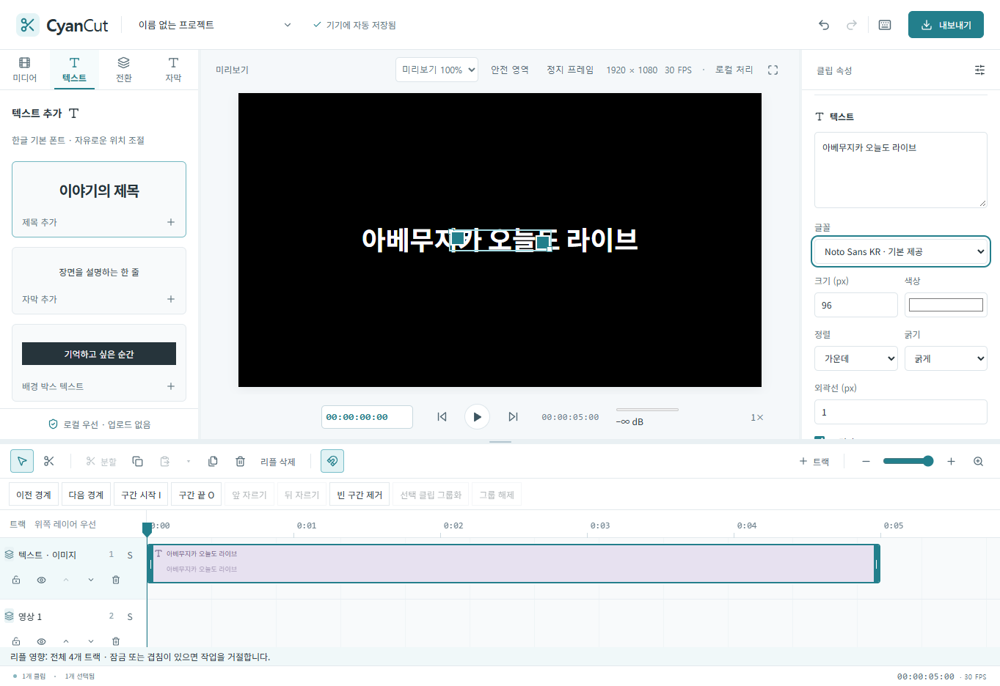
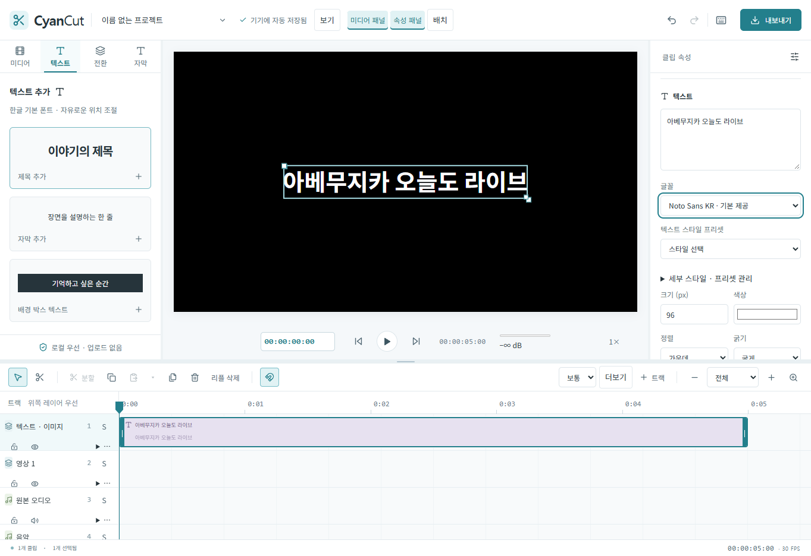
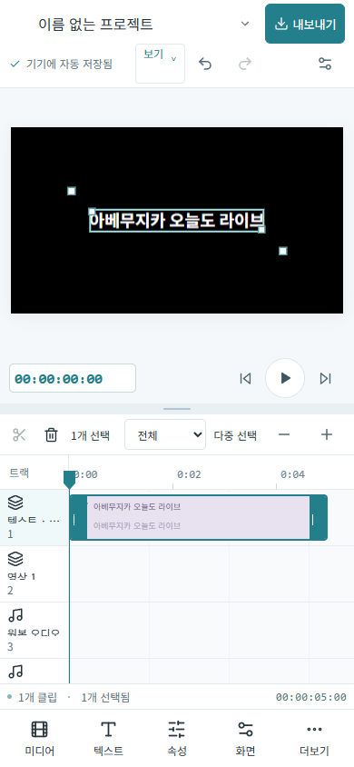

# 실사용 개선 지시서 이행 · 2026-11-18

대상은 사용자가 지정한 `CyanCut_AI_Development_Instructions.md`의 DEV-01–14다. 기존 React/TypeScript·로컬 미디어·Worker·정수 마이크로초 모델을 유지했다. 원본을 서버로 전송하는 경로는 추가하지 않았다. 기존 흰색/단방향 전환과 이전 텍스트는 의미를 보존하고 새 전환에만 version 2를 기록한다.

## 문제·변경·위험

| 우선순위 / ID | 확인한 코드와 문제 | 실제 변경 | 위험과 검증 |
| --- | --- | --- | --- |
| P0 DEV-08/11 | Inspector/CaptionPanel의 blur 입력 때문에 프로젝트와 입력란 값이 달랐다. 저장 표시는 이전 상태를 대상으로 했다. | `LiveTextInput`, App의 clipId/projectId 귀속 입력. 즉시 revision 증가·저장 대기, 포커스 세션별 undo. 조합 종료의 최종 값 처리. 새 텍스트는 빈 문자열과 placeholder. | 저장/undo 핵심 경로이므로 높음. 실제 UI에서 포커스를 유지한 입력→undo/redo→재열기→MP4 다운로드 후 디코딩 비교. 한글 IME 이벤트는 합성이며 실제 안드로이드 키보드와 구분. |
| P1 DEV-01/09 | Preview 자체 설정 헤더와 상시 정밀 도구 행, 작은 창의 고정 패널이 작업 공간을 점유했다. | 헤더 보기 메뉴, 좌우 개별 접기, 3개 배치/초기화와 기기별 유효 범위 제한. 좁은 창은 기존 모바일 시트 공유. 정밀 도구를 더보기로 이동. | 중간. 7개 화면 크기의 캔버스·트랙·페이지 넘침 측정. 작은 화면에서 3개 트랙 확보와 프리뷰 크기 사이의 교환이 있다. |
| P1 DEV-05/12 | 가져온 전체 파일이 자동 배치 선택되어 카드 하나의 드래그가 혼합 종류 전체를 실었다. 드롭 안내가 트랙을 아래로 밀었다. 보관함 위 설명이 길었다. | 명시적 선택 모드, 단일 카드 드래그 기본값, Pointer Events 전용 핸들과 키보드 Enter 대안. 고스트/스냅/스크롤/취소·잠금 방어. 카드 우선 배치와 접힌 가져오기/저장 설정. 빈 메타데이터 구분자 제거. | 중간. 실제 MP4+연결 음성/투명 PNG/WAV 배치·undo·영역 밖/Escape/잠금 검사. 실기기 터치는 별도 미검증. |
| P1 DEV-03 | 기본 프로젝트명 반복과 출력 이름 충돌. | 첫 실제 배치 원본으로 자동명, 수동명 보존. export intent별 지역 시간·순번을 고정하고 경로 문자/중복 확장자/긴 이름을 정리. 긴 이름에서도 순번을 보존. | 낮음. 순수 이름 규칙과 실제 다운로드 검사. 자동명은 콘텐츠 판정과 무관. |
| P1 DEV-04 | legacy 효과별 길이 의미가 다르고 가운데 전환이 없었다. | 디졸브/검정 경유/슬라이드/와이프 핵심 팔레트. 전체 프레임 수·홀수 분배·원본 핸들·이웃 전환 제한. 공유 layers/render 합성, 선택적 링크 원본 음성 곡선. 흰색은 이전 효과 유지. | 높음. 4종×24/30/60fps의 실제 MP4 5시점과 합성기 비교, 부족 핸들/잠금/legacy 단위 검사. 영상 길이와 BGM 위치를 바꾸지 않는다. |
| P1 DEV-06 | 작은 객체의 시각 핸들과 히트 영역이 겹쳤다. | 외부 핸들, 7px 시각 표시와 별도 포인터 영역, 선택 객체 방향키 1px/Shift 10px. | 중간. 숫자 속성과 Undo 대안을 유지. |
| P1 DEV-07 | 연속 px/sec 슬라이더, 입력 때 초기 자동 fit 발동. | 전체/60/30/15/10/5/1초·선택 맞춤. 표시 폭에서 배율을 계산하고 작업 위치를 보정. 첫 배치만 초기 fit, 프로젝트별 저장. 룰러의 화면 밖 tick 연산 제거. | 중간. 입력 후 배율 유지·패널 개폐, 드래그 시간 좌표와 기존 편집 흐름 확인. |
| P2 DEV-10 | 글꼴 1개와 제한된 재사용 스타일. | OFL 한글 3종(고딕2+명조1), 실제 400/700. 6개 스냅샷 프리셋, 고급 줄바꿈/자간/알파/윤곽/그림자/박스/앵커, 스타일 복사 및 사용자 프리셋 CRUD. 공유 Canvas 레이아웃·grapheme 줄바꿈. | 중간. 720/1080 가로·세로 실제 MP4와 6개 프리셋의 출력 프레임 비교. 실패한 폰트를 조용히 대체하지 않고 수동 선택과 재시도 안내. 사용자 TTF 업로드는 범위 밖. |
| P2 DEV-13/14 | 트랙 순서/삭제가 상시 노출, 작은 조작 영역. | 3단계 트랙 높이, 순서/삭제 메뉴, 핵심 잠금/숨김/음소거 유지. 상태/포커스/이름과 Escape 제공. | 낮음~중간. 기존 잠금·링크·그룹·모바일 조작 회귀. 전체 스크린리더/WCAG 인증을 주장하지 않는다. |

## DEV-02 출력 측정

Windows Chrome 157, AMD Ryzen 3 4100(4코어), RAM 약 16.96GB. WebCodecs AVC + 기기 지원 AAC/로컬 AAC 경로, 8Mbps, 1080p. 동일 원본/프로젝트로 변경 전후 각각 첫 실행+준비 후 3회, 총 32개 실제 파일 출력을 수행했다. 품질/FPS/해상도는 낮추지 않았다.

| 프로젝트 | 변경 전 준비 후 중앙값 | 변경 후 준비 후 중앙값 | 단축 | 유효 처리 FPS | 출력 바이트 |
| --- | ---: | ---: | ---: | ---: | ---: |
| B1 60초·30fps 단일 영상/음성 | 16.346초 | 15.399초 | 5.79% | 116.89 | 2,419,387 |
| B2 60초·자막20·PNG5·음악·legacy 경계4 | 16.080초 | 15.640초 | 2.73% | 115.09 | 4,962,464 |
| B3 5분·자막100 | 75.771초 | 74.925초 | 1.12% | 120.12 | 23,658,631 |
| B4 60초·60fps 움직이는 도형 | 32.259초 | 30.354초 | 5.91% | 118.60 | 3,403,708 |

**20% 목표에는 미달했다.** 주 병목은 네이티브 영상 인코딩/역압 대기다. 한 프레임의 영상 인코딩 대기 동안 독립적인 오디오 청크를 처리하고, 소비 완료를 모두 기다린 뒤 다음 캔버스 프레임을 생산한다. 무제한 병렬 프레임/PCM 배열을 만들지 않는다. 텍스트 폰트 준비는 프로젝트/문자열이 바뀔 때만, 레이아웃은 상한 64개 캐시로 재사용한다. 인코딩 큐 최고 4, 패킷 수 1,800/9,000/3,600을 확인했다.

단계별 시간은 서로 겹친다(render에 decode 포함, encode에 backpressure 포함). 합산해서 전체 시간으로 해석하면 안 된다. 하드웨어 인코딩 여부나 프로세스 전체 peak memory를 확인할 수 없어 수치를 만들지 않았다. B3는 오디오 패킷 경계 수정 때문에 바이트 수가 달라졌다. 같은 바이트 수인 다른 결과도 파일 전체 bit 일치라는 의미는 아니다.

B4 warm 개별 값에는 30.354/30.330/35.948초의 변동이 있다. 중앙값 표를 모든 단일 실행의 개선 보장으로 해석하지 않는다. 변동 원인 분리는 완료하지 않았다.

별도 B2-v2(새 디졸브/검정 경유/슬라이드/와이프 4종+자막20+PNG5+톤 BGM)는 첫 15.895초, warm 15.846/15.693/15.870초, 중앙값 **15.846초**였다. 출력 4,861,793B·1,800패킷이며, 이전 엔진의 동등한 새 효과가 없어 이 수치를 전후 속도 개선율로 표시하지 않는다. [새 효과 원자료](results/directive-benchmark-after-v2.json).

B2는 변경 전에도 재생 가능한 **기존 전환 경계 4개**로 전후 조건을 고정했다. 새로운 네 종류의 v2 전환 검증은 별도 MP4 프레임 검사다. B4는 실제 게임/촬영본을 제공받지 못해 합성 SDR 도형과 톤으로 대체했다. 따라서 지시서의 실제 게임 영상 성능 검증은 미완료다. 동일 Worker를 반복 사용했으므로 첫 실행 칼럼도 매번 새 브라우저/모듈 cold start는 아니다. 모듈 cold는 B1, 텍스트 폰트 최초 로드는 B2에 해당한다. UI 작업마다 새 Worker를 만드는 환경의 전체 지연과 구분한다.

[실측 단계·첫 실행·개별 실행값](results/directive-benchmark.json). 반복 측정의 원본 분석(probe/import)은 준비 단계로 별도 수행했으며 출력 wallMs에 포함되지 않는다. `demux/resource`는 출력 시 리소스 개방 비용이다. import부터의 전체 대기 시간이나 cold startup을 측정했다는 의미가 아니다.

재현: `node scripts/bench-directive.mjs` 및 `node scripts/summarize-directive.mjs`(별도 보존한 baseline/candidate 빌드와 합성 fixtures 필요). B3 결과의 시작·중간·끝 영상 PTS/오디오 PTS/RMS를 검사했으며 사람이 청취한 정밀 동기화 검증과 구분한다.

## 공간 측정

같은 제목 클립·동일 창 크기의 CSS 영상 영역. 균형 배치에서 완전히 보이는 트랙 수는 1→3개다. 초기 캔버스 확대만을 목표로 하지 않고 트랙을 동시에 조작할 공간을 확보했다.

| 창 | 변경 전 영상 | 변경 후 영상 | 후 트랙 수 | 페이지 가로 넘침 |
| --- | --- | --- | ---: | --- |
| 1440×900 | 649×365 | 718×404 | 3 | 없음 |
| 1363×936 | 713×401 | 779×438 | 3 | 없음 |
| 1280×720 | 436×245 | 398×224 | 3 | 없음 |
| 1024×768 | 532×299 | 444×250 | 3 | 없음 |
| 768×1024 | 별도 원본 JSON 참조 | 744×419 | 3 | 없음 |
| 640×800 | 별도 원본 JSON 참조 | 418×235 | 3 | 없음 |
| 390×844 | 별도 원본 JSON 참조 | 366×206 | 3 | 없음 |

1280/1024에서는 트랙을 확보하면서 초기 프리뷰가 작아졌다. 프리뷰 중심/패널 접기로 전환할 수 있다. 전체 창의 높이를 더 소비하는 두 번째 정밀 도구 행은 없다. 캡처·수치는 `scripts/capture-directive.mjs`로 재현한다. 합성 제목을 사용했으며 사용자 원본을 보고서에 넣지 않았다.

변경 전 좁은 창의 0×0은 당시 기본 모드에서 미디어 탭이 프리뷰를 숨긴 상태다. 기존 9:16 캔버스 결함이 재발했다는 의미로 해석하지 않는다. [변경 전 원자료](results/directive-layout-before.json) · [변경 후 원자료](results/directive-layout-after.json).

## 추가로 재현한 오디오 경계 결함

실제 AAC 입력을 스트리밍 믹싱할 때 계산한 시각과 디코더 패킷 시작 시각이 부동소수점 오차만큼 달라 한 샘플이 0으로 빠졌다. `AudioCursor.sample`은 1ns 미만의 동등한 경계를 같은 위치로 처리하고 패킷 끝 보간 인덱스를 유효 범위로 제한한다. 실제 공백은 계속 무음으로 유지한다. 전체 톤의 최대 인접 샘플 차이는 0.12196→0.02344, 디졸브 경계에서는 0.06917→0.02112로 줄었다. 최대 피크는 클리핑 범위 미만이며, 원본 음성 전환을 켜도 BGM 차이는 1.5e-8 이하였다. [수정 전](results/directive-audio-boundary-before.json) · [수정 후/실제 MP4](results/directive-extended-transitions.json). 이는 합성 톤 측정이며 모든 음악/음성의 청취 품질을 보증하지 않는다.

720p 비교용 4종 실제 샘플은 로컬 `artifacts/directive-transition-{dissolve,black,slide,wipe}.mp4`, 검증 수치는 [샘플 정보](results/directive-transition-samples.json)에 있다. 생성: `node scripts/transition-samples.mjs`(localhost:5174 필요). 미디어 artifacts는 AGENTS 지침에 따라 커밋하지 않았다.

## 검증과 제한

검증 결과와 운영 배포는 [VERIFICATION.md](VERIFICATION.md)의 이번 패스 기록을 기준으로 한다. 사용자 요구 11가지는 DEV-01(공간/모바일), 02(출력), 03(이름), 04(전환), 05(드래그), 06(핸들), 07(배율), 08/11(자막/저장), 09(상시 도구 행), 10(스타일), 12/13/14(보관함/트랙/접근성)에 연결했다.

Galaxy/Samsung Internet/Android IME·iPad/Safari·실제 가상 키보드/회전·실제 게임 1080p60의 전후 성능·HDR·장시간 복잡한 4K의 자원 한계는 미검증이다. 고정 용량/길이 상한을 다시 추가하지 않았으며 저장소/메모리/코덱의 실제 기기 한계는 남는다. 기본 색상·720p/1080p 결과·자동 보관/누락 원본·MP4/WebM/WAV/MP3 경로는 기존 회귀 검증 대상으로 유지한다.

기본 전환 길이는 사용자가 고른 공통 설정을 유지하는 0.4초로 시작한다. 지시서의 슬라이드/와이프 0.35초 제안값은 직접 입력할 수 있으며 종류를 바꿀 때 기존 길이 선택을 덮어쓰지 않는 쪽을 택했다. 안전 영역을 켜면 객체 기준점을 10/50/90% 가이드에 스냅하며 숫자/키보드 미세 이동은 유지한다. 메뉴 summary의 Space는 재생 단축키와 충돌하지 않는다.
